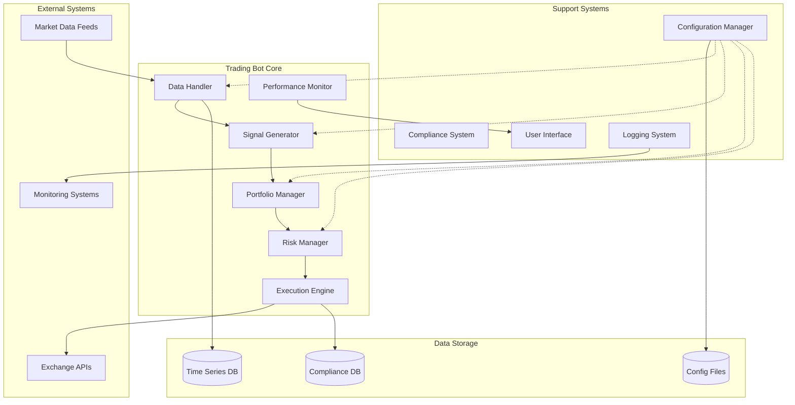
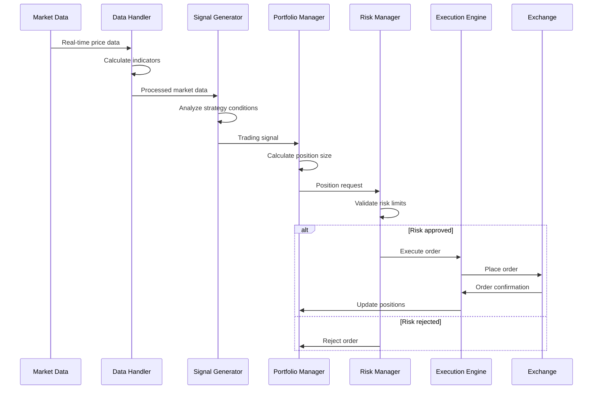

# Trading Bot System Design Document

## Overview

The Trading Bot System is a modular, event-driven Python application designed for automated cryptocurrency and financial instrument trading. The system follows a microservices-inspired architecture with loosely coupled components communicating through well-defined interfaces. The design emphasizes real-time performance, fault tolerance, and regulatory compliance while maintaining extensibility for new trading strategies and exchange integrations.

The system operates on an event-driven architecture where market data flows through a pipeline of processing components, generating trading signals that are evaluated by risk management systems before execution. All operations are logged and monitored for performance analysis and regulatory compliance.

## Architecture

### High-Level Architecture



### Component Interaction Flow



## Components and Interfaces

### Data Handler

**Purpose**: Manages real-time and historical market data ingestion, processing, and technical indicator calculation.

**Key Responsibilities**:
- Establish and maintain WebSocket connections to exchange data feeds
- Normalize data formats across different exchanges
- Calculate technical indicators (RSI, moving averages, MACD, Bollinger Bands)
- Maintain sliding windows of historical data for strategy analysis
- Handle data feed failures and implement failover mechanisms

**Interface**:
```python
class DataHandler:
    def subscribe_to_symbol(self, symbol: str, timeframe: str) -> None
    def get_latest_price(self, symbol: str) -> Price
    def get_indicator_value(self, symbol: str, indicator: str) -> float
    def get_historical_data(self, symbol: str, periods: int) -> DataFrame
    def register_data_callback(self, callback: Callable[[MarketData], None]) -> None
```

**Data Models**:
```python
@dataclass
class Price:
    symbol: str
    timestamp: datetime
    bid: Decimal
    ask: Decimal
    last: Decimal
    volume: Decimal

@dataclass
class MarketData:
    symbol: str
    timestamp: datetime
    ohlcv: OHLCV
    indicators: Dict[str, float]
```

### Signal Generator

**Purpose**: Analyzes processed market data and generates buy/sell signals based on configured trading strategies.

**Key Responsibilities**:
- Implement scalping strategy logic (short-term price movements, high frequency)
- Implement swing trading strategy logic (medium-term trends, lower frequency)
- Evaluate multiple timeframes for signal confirmation
- Generate signal strength and confidence levels
- Maintain strategy state and position tracking

**Interface**:
```python
class SignalGenerator:
    def analyze_market_data(self, data: MarketData) -> Optional[TradingSignal]
    def set_strategy(self, strategy: TradingStrategy) -> None
    def get_strategy_state(self, symbol: str) -> StrategyState
    def backtest_strategy(self, historical_data: DataFrame) -> BacktestResults
```

**Strategy Implementations**:
```python
class ScalpingStrategy(TradingStrategy):
    # Entry: RSI oversold/overbought + volume spike
    # Exit: Quick profit target (0.1-0.5%) or stop loss
    # Timeframe: 1-5 minutes
    
class SwingTradingStrategy(TradingStrategy):
    # Entry: Moving average crossover + trend confirmation
    # Exit: Trend reversal or profit target (2-5%)
    # Timeframe: 1-4 hours
```

### Portfolio Manager

**Purpose**: Manages portfolio allocation, position sizing, and overall portfolio risk distribution.

**Key Responsibilities**:
- Calculate optimal position sizes based on Kelly Criterion or fixed fractional methods
- Track current positions and available capital
- Implement portfolio-level risk limits
- Manage correlation between positions
- Handle position updates from executed trades

**Interface**:
```python
class PortfolioManager:
    def calculate_position_size(self, signal: TradingSignal) -> PositionSize
    def get_current_positions(self) -> List[Position]
    def get_available_capital(self) -> Decimal
    def update_position(self, trade: ExecutedTrade) -> None
    def get_portfolio_metrics(self) -> PortfolioMetrics
```

### Risk Manager

**Purpose**: Enforces all risk management rules and acts as the final gatekeeper for trade execution.

**Key Responsibilities**:
- Validate position sizes against maximum risk per trade
- Enforce stop-loss and take-profit levels
- Monitor portfolio-level drawdown limits
- Implement emergency stop mechanisms
- Track and limit daily/weekly loss limits

**Interface**:
```python
class RiskManager:
    def validate_trade(self, trade_request: TradeRequest) -> RiskValidationResult
    def monitor_positions(self) -> None
    def trigger_emergency_stop(self, reason: str) -> None
    def update_stop_loss(self, position_id: str, new_stop: Decimal) -> None
    def get_risk_metrics(self) -> RiskMetrics
```

**Risk Rules**:
- Maximum 2% risk per trade
- Maximum 10% portfolio drawdown before halt
- Maximum 5% daily loss limit
- Position correlation limits to prevent concentration risk

### Execution Engine

**Purpose**: Handles order placement, execution monitoring, and trade lifecycle management.

**Key Responsibilities**:
- Place market and limit orders across multiple exchanges
- Monitor order status and handle partial fills
- Implement smart order routing for best execution
- Handle order rejections and retry logic
- Maintain order book and execution history

**Interface**:
```python
class ExecutionEngine:
    def place_order(self, order: OrderRequest) -> OrderResult
    def cancel_order(self, order_id: str) -> CancelResult
    def get_order_status(self, order_id: str) -> OrderStatus
    def get_execution_history(self, symbol: str) -> List[ExecutedTrade]
    def get_open_orders(self) -> List[OpenOrder]
```

### Performance Monitor

**Purpose**: Calculates and tracks comprehensive performance metrics for strategy evaluation.

**Key Responsibilities**:
- Calculate Sharpe ratio, Sortino ratio, and maximum drawdown
- Track win rate, average profit/loss, and profit factor
- Generate performance reports and visualizations
- Compare performance across different strategies and timeframes
- Maintain performance history for trend analysis

**Interface**:
```python
class PerformanceMonitor:
    def calculate_sharpe_ratio(self, returns: List[float]) -> float
    def calculate_max_drawdown(self, equity_curve: List[float]) -> float
    def generate_performance_report(self, period: str) -> PerformanceReport
    def update_trade_metrics(self, trade: ExecutedTrade) -> None
    def get_real_time_metrics(self) -> Dict[str, float]
```

## Data Models

### Core Trading Models

```python
@dataclass
class TradingSignal:
    symbol: str
    direction: SignalDirection  # BUY, SELL
    strength: float  # 0.0 to 1.0
    confidence: float  # 0.0 to 1.0
    timestamp: datetime
    strategy: str
    metadata: Dict[str, Any]

@dataclass
class Position:
    symbol: str
    quantity: Decimal
    entry_price: Decimal
    current_price: Decimal
    unrealized_pnl: Decimal
    stop_loss: Optional[Decimal]
    take_profit: Optional[Decimal]
    timestamp: datetime

@dataclass
class OrderRequest:
    symbol: str
    side: OrderSide  # BUY, SELL
    order_type: OrderType  # MARKET, LIMIT
    quantity: Decimal
    price: Optional[Decimal]
    stop_loss: Optional[Decimal]
    take_profit: Optional[Decimal]
    time_in_force: TimeInForce  # GTC, IOC, FOK
```

### Configuration Models

```python
@dataclass
class TradingConfig:
    symbols: List[str]
    timeframes: List[str]
    strategy: str
    risk_per_trade: float
    max_drawdown: float
    daily_loss_limit: float
    exchange_configs: Dict[str, ExchangeConfig]

@dataclass
class ExchangeConfig:
    name: str
    api_key: str
    api_secret: str
    sandbox: bool
    rate_limit: int
    timeout: int
```

## Error Handling

### Error Categories and Responses

**Network Errors**:
- Connection timeouts: Implement exponential backoff with jitter
- API rate limits: Queue requests and implement token bucket algorithm
- WebSocket disconnections: Automatic reconnection with state recovery

**Data Errors**:
- Invalid price data: Skip corrupted data points and log warnings
- Missing indicators: Use fallback calculations or previous values
- Timestamp inconsistencies: Implement data validation and correction

**Trading Errors**:
- Insufficient funds: Reduce position size or skip trade
- Order rejections: Retry with adjusted parameters or cancel
- Execution failures: Implement order status monitoring and recovery

**System Errors**:
- Component failures: Implement circuit breakers and graceful degradation
- Database errors: Use local caching and retry mechanisms
- Configuration errors: Validate on startup and provide clear error messages

### Error Recovery Strategies

```python
class ErrorHandler:
    def handle_network_error(self, error: NetworkError) -> RecoveryAction
    def handle_trading_error(self, error: TradingError) -> RecoveryAction
    def handle_data_error(self, error: DataError) -> RecoveryAction
    def trigger_emergency_shutdown(self, reason: str) -> None
```

## Testing Strategy

### Dual Testing Approach

The testing strategy combines comprehensive unit testing for specific scenarios with property-based testing for universal correctness validation. This dual approach ensures both concrete bug detection and general system reliability.

**Unit Testing Focus**:
- Specific trading scenarios and edge cases
- Error condition handling and recovery
- Component integration points
- Configuration validation
- Exchange API mocking and simulation

**Property-Based Testing Focus**:
- Universal trading rules and invariants
- Risk management constraints
- Data processing correctness
- Performance metric calculations
- System state consistency

### Testing Configuration

**Property-Based Testing Setup**:
- Use Hypothesis library for Python property-based testing
- Configure minimum 100 iterations per property test
- Each property test references its corresponding design property
- Tag format: **Feature: trading-bot-system, Property {number}: {property_text}**

**Unit Testing Setup**:
- Use pytest framework with comprehensive fixtures
- Mock external dependencies (exchanges, data feeds)
- Test coverage target: 90% for core trading logic
- Integration tests for end-to-end trading workflows

### Test Data Management

- Historical market data for backtesting validation
- Synthetic data generation for edge case testing
- Mock exchange responses for API testing
- Performance benchmarking datasets

## Correctness Properties

*A property is a characteristic or behavior that should hold true across all valid executions of a system—essentially, a formal statement about what the system should do. Properties serve as the bridge between human-readable specifications and machine-verifiable correctness guarantees.*

### Property 1: Strategy Consistency
*For any* trading strategy and identical market conditions, the Signal Generator should always produce the same trading signals with identical strength and confidence levels.
**Validates: Requirements 1.2**

### Property 2: Signal Generation Correctness
*For any* market data that meets configured strategy criteria, the Signal Generator should generate appropriate buy or sell signals that align with the strategy's entry rules.
**Validates: Requirements 1.4**

### Property 3: Position Sizing Accuracy
*For any* portfolio state and risk parameters, the Portfolio Manager should calculate position sizes that never exceed the configured maximum risk per trade percentage.
**Validates: Requirements 1.5, 3.4**

### Property 4: API Authentication Consistency
*For any* exchange API call, the Trading Bot should include proper authentication headers and credentials as required by the exchange's authentication protocol.
**Validates: Requirements 2.2**

### Property 5: Rate Limit Handling
*For any* sequence of API requests that would exceed rate limits, the Trading Bot should queue requests and implement exponential backoff without losing any requests.
**Validates: Requirements 2.3**

### Property 6: Input Validation Completeness
*For any* invalid API response or malformed data input, the Trading Bot should reject the input and continue operating without processing the invalid data.
**Validates: Requirements 2.5, 5.4**

### Property 7: Risk Management Enforcement
*For any* trading position, the Risk Manager should enforce stop-loss and take-profit orders when trigger conditions are met, and prevent new positions when portfolio risk exceeds configured thresholds.
**Validates: Requirements 3.1, 3.2, 3.3, 3.6**

### Property 8: Emergency Response Consistency
*For any* emergency condition detection, the Risk Manager should immediately close all open positions and halt new trading activities until the emergency is resolved.
**Validates: Requirements 3.5**

### Property 9: Performance Metric Accuracy
*For any* sequence of trading returns, the Performance Monitor should calculate Sharpe ratio, win rate, and drawdown metrics that match standard financial calculation formulas.
**Validates: Requirements 4.1, 4.2**

### Property 10: Performance Data Persistence
*For any* calculated performance metrics, the Performance Monitor should store results with accurate timestamps and generate reports in valid JSON and CSV formats.
**Validates: Requirements 4.3, 4.4**

### Property 11: Technical Indicator Correctness
*For any* price data sequence, the Data Handler should calculate technical indicators (RSI, moving averages) that match standard financial indicator formulas within acceptable precision.
**Validates: Requirements 5.2**

### Property 12: Data Storage Format Consistency
*For any* processed market data, the Data Handler should store it in time-series format with consistent schema and proper indexing for backtesting retrieval.
**Validates: Requirements 5.6**

### Property 13: Audit Trail Completeness
*For any* trading decision or order execution, the Compliance System should create audit trail entries with all required fields (timestamp, action, parameters, result) and maintain them persistently.
**Validates: Requirements 8.3, 8.4**

### Property 14: Compliance Report Generation
*For any* compliance data set, the Compliance System should generate reports in standardized formats with all required regulatory fields and proper data validation.
**Validates: Requirements 8.5**

### Property 15: Configuration Validation
*For any* configuration input, the Configuration Manager should validate all values against predefined ranges and constraints, rejecting invalid configurations with descriptive error messages.
**Validates: Requirements 9.2**

### Property 16: Dynamic Configuration Application
*For any* configuration change, the Configuration Manager should apply the new settings without requiring system restart and maintain version history for rollback capabilities.
**Validates: Requirements 9.3, 9.4**

### Property 17: Sensitive Data Encryption
*For any* sensitive configuration data (API credentials, private keys), the Configuration Manager should encrypt the data at rest using strong encryption algorithms.
**Validates: Requirements 9.6**

### Property 18: Backtesting Simulation Accuracy
*For any* historical market data and trading strategy, the backtesting engine should simulate order execution with realistic slippage and fees that reflect actual trading conditions.
**Validates: Requirements 10.2**

### Property 19: Trading Mode Separation
*For any* trading operation, the system should maintain separate performance tracking and clearly indicate whether it's operating in live, paper, or backtesting mode.
**Validates: Requirements 10.4, 10.5, 10.6**

### Property 20: Comprehensive Logging
*For any* system operation (trading decisions, errors, configuration changes), the Trading Bot should create structured log entries with appropriate log levels and timestamps.
**Validates: Requirements 11.1, 11.2, 11.3**

### Property 21: Log Management
*For any* log file growth, the system should automatically rotate logs to prevent disk space issues while maintaining log integrity and searchability.
**Validates: Requirements 11.4**

### Property 22: Health Check Reliability
*For any* health check request, the system should respond with accurate status information reflecting the current operational state of all critical components.
**Validates: Requirements 11.6**

### Property 23: Security Access Control
*For any* administrative operation or configuration change, the system should enforce proper access controls and audit all security-related events.
**Validates: Requirements 12.4, 12.5**

### Property 24: Token Management Security
*For any* authentication token storage or refresh operation, the system should implement secure token management practices including encryption and automatic refresh before expiration.
**Validates: Requirements 12.3**

### Property 25: Encryption at Rest
*For any* sensitive data stored by the system, all API credentials and private configuration data should be encrypted using industry-standard encryption algorithms.
**Validates: Requirements 12.1**